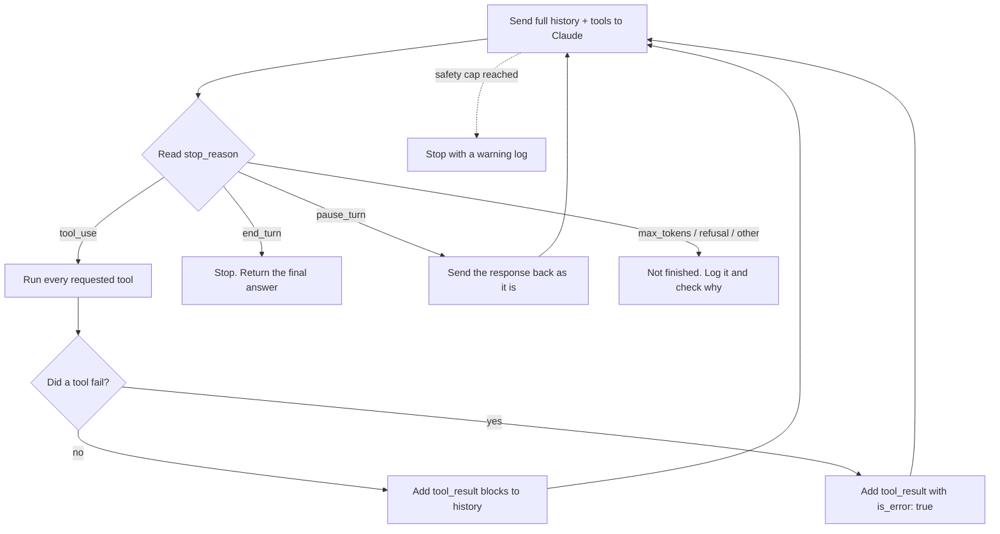

# 01 · Agentic Loops

**Exam link:** Task Statement 1.1: *Design and implement agentic loops for autonomous task execution.*
**Prerequisite:** [00 · Foundations](00-foundations-and-glossary.md) (tool, `tool_use`, `tool_result`, stateless API).

---

## 1. What is an agentic loop?

An **agentic loop** is the engine of every agent. It repeats four steps:

1. **Send** the conversation (and the tool list) to Claude.
2. **Inspect** the response. Did Claude ask for tools, or is it finished?
3. **Execute** the requested tools in your code.
4. **Return** the tool results to Claude by adding them to the conversation. Go back to step 1.

The loop ends when `stop_reason` is `"end_turn"`: Claude has finished.



If the Mermaid diagram does not render, here is the same loop in plain text:

```text
        +--------------------------------------------+
        |  1. Send full history + tools to Claude    |<-----------+
        +--------------------------------------------+            |
                            |                                     |
                    2. read stop_reason                           |
          +-----------------+-------------------+                 |
     "end_turn"        "tool_use"         anything else           |
          |                 |                   |                 |
     STOP: return     3. run each tool     not finished:          |
     final answer           |              log + investigate      |
                      4. add tool_result                          |
                      blocks (is_error if                         |
                      a tool failed) ------- 5. repeat -----------+
```

---

## 2. `stop_reason`: the signal that drives the loop

Every response from the Messages API has a field called **`stop_reason`**. It tells you *why* Claude stopped writing. This field, and nothing else, should control your loop.

| `stop_reason` | Meaning | What the loop should do |
|---|---|---|
| `"tool_use"` | Claude wants one or more tools to run | Run the tools, append results, **continue** |
| `"end_turn"` | Claude has finished its answer | **Stop** and return the answer |
| `"max_tokens"` | The response hit the `max_tokens` limit and was cut off | Treat as incomplete: raise the limit or continue the output; do not treat as "done" |
| `"pause_turn"` | A long-running *server-side* tool (e.g. web search run by Anthropic) paused the turn | Send the conversation back so Claude can continue |
| `"stop_sequence"` | Claude wrote one of your custom stop strings | Handle according to your design |
| `"refusal"` | Claude declined the request for safety reasons | Do not run tools; handle the refusal (log, fall back, or inform the user) |
| `"model_context_window_exceeded"` | The context window is full | Treat as incomplete: reduce the context (trim, summarize, or start fresh with a summary) |

The docs list these seven values (see the Sources checked table in the [README](README.md)). For the exam, the two that matter most are **`tool_use` → continue** and **`end_turn` → stop**.

---

## 3. How tool results feed the next step

When Claude asks for a tool, the assistant message contains a `tool_use` block with an `id`, a `name`, and an `input`:

```json
{"type": "tool_use", "id": "toolu_01A", "name": "lookup_order", "input": {"order_id": "4471"}}
```

Your code runs the tool and sends back a **user** message with a matching `tool_result` block:

```json
{"type": "tool_result", "tool_use_id": "toolu_01A", "content": "{\"status\": \"charged_twice\", \"amount\": 89.00}"}
```

Key rules:

- **Both** the assistant's `tool_use` message *and* your `tool_result` message are appended to the history. Claude needs to see what it asked for and what came back.
- The `tool_use_id` must match the `id` of the request.
- Tool results are sent in a message with role **`user`**.
- If Claude asked for **several tools in one response** (parallel tool calls), return **all** the results together in **one** user message.
- If a tool fails, still return a `tool_result`, with `"is_error": true` and a useful error message. Do not silently drop it. Claude can then retry, try another approach, or explain the problem.
- In the user message, all `tool_result` blocks must come **first**. Any text must come after them, or the API returns an error.
- Every `tool_use` needs a matching `tool_result`. If one is missing, the next API call fails.
- **API errors are different from tool errors.** If the API call itself fails (for example, the service is busy), you get no response at all. Retry the API call with **backoff**: wait a little longer after each failed try.

Because the history grows with each step, Claude can **reason about new information**. For example, after `lookup_order` shows a double charge, it can decide to call `process_refund`.

---

## 4. A complete loop in Python

This uses the official `anthropic` Python SDK and the Messages API.

```python
import json
import anthropic

client = anthropic.Anthropic()  # reads credentials from the environment, never hard-code keys

TOOLS = [...]  # tool definitions (name, description, input_schema)


def execute_tool(name: str, tool_input: dict) -> str:
    """Run the real tool. Returns a JSON string. Raises on failure."""
    ...


def run_agent(user_request: str) -> str:
    messages = [{"role": "user", "content": user_request}]
    safety_limit = 25  # a safety net only, NOT the normal way the loop ends

    for _ in range(safety_limit):
        response = client.messages.create(
            model="claude-opus-5-5",
            max_tokens=16000,
            tools=TOOLS,
            messages=messages,
        )

        # Always keep the full assistant content (text, tool_use, and any other blocks)
        messages.append({"role": "assistant", "content": response.content})

        if response.stop_reason == "end_turn":
            # Normal finish: the model decided it is done
            return "".join(b.text for b in response.content if b.type == "text")

        if response.stop_reason == "tool_use":
            tool_results = []
            for block in response.content:
                if block.type != "tool_use":
                    continue
                try:
                    output = execute_tool(block.name, block.input)
                    tool_results.append(
                        {"type": "tool_result", "tool_use_id": block.id, "content": output}
                    )
                except Exception as exc:
                    # Report the failure to the model instead of hiding it
                    tool_results.append({
                        "type": "tool_result",
                        "tool_use_id": block.id,
                        "content": json.dumps({"error": str(exc)}),
                        "is_error": True,
                    })
            # All results for this turn go back in ONE user message
            messages.append({"role": "user", "content": tool_results})
            continue

        if response.stop_reason == "pause_turn":
            continue  # the assistant turn is already appended; resend so it can resume

        # max_tokens, refusal, or anything unexpected: stop and report, do not pretend success
        raise RuntimeError(f"Agent stopped early: stop_reason={response.stop_reason}")

    # Reaching here means something is wrong (e.g. the agent is stuck in a loop)
    raise RuntimeError("Safety limit reached; escalate or investigate")
```

> **Note:** The Python SDK also offers a **Tool Runner** (`client.beta.messages.tool_runner`) that runs this loop for you, and the Agent SDK runs it inside `query()`. The exam still expects you to understand the loop because it explains all higher-level tools.

---

## 5. Model-driven decisions vs pre-configured decision trees

There are two ways to decide what happens next:

| | **Model-driven** | **Pre-configured (decision tree / fixed sequence)** |
|---|---|---|
| How | Claude reads the context and picks the next tool | Code says "after A, always call B, then C" |
| Strength | Adapts to unusual cases | Predictable, easy to audit |
| Weakness | Can make a wrong choice | Breaks on cases nobody planned for |

**Example: support agent.** A customer asks about a missing parcel *and* a wrong address.

- A fixed decision tree built for "missing parcel" ignores the address question.
- A model-driven loop sees both issues and calls `lookup_order` and `update_address`.

**Best practice:** let the model drive the *order of investigation*, and use code to enforce the few steps that are *mandatory* (see [04](04-workflow-enforcement-and-handoffs.md) and [05](05-agent-sdk-hooks.md)).

---

## 6. Anti-patterns the exam tests

These are the "wrong answer" designs. Learn to spot them.

### ❌ Anti-pattern 1: Parsing natural language to decide when to stop

```python
# WRONG
if "I'm done" in text or "task complete" in text.lower():
    break
```

Why it is wrong: the wording changes. Claude might say "All finished!" or might mention "done" while still working. The API already gives you a reliable, structured signal: `stop_reason`.

### ❌ Anti-pattern 2: Using an iteration cap as the main stopping rule

```python
# WRONG as the primary mechanism
for i in range(5):
    response = client.messages.create(...)
    ...  # no stop_reason check
```

Why it is wrong: a fixed number of rounds either stops too early (task half done) or wastes calls (task already done). A cap is fine as a **safety net** to stop runaway loops, but the loop should normally end on `end_turn`.

### ❌ Anti-pattern 3: Checking for assistant text as a "completion indicator"

```python
# WRONG
if any(b.type == "text" for b in response.content):
    break  # "Claude wrote text, so it must be done"
```

Why it is wrong: Claude often writes text *and* calls a tool in the same response ("Let me check your order..." + `tool_use`). Text does not mean finished. Only `stop_reason == "end_turn"` means finished.

### ❌ Anti-pattern 4: Not appending tool results

If you run the tool but don't add the `tool_result` to the history, Claude doesn't know what happened. It may call the same tool again and again.

### ❌ Anti-pattern 5: Forcing `tool_choice: "any"` inside the loop

With `"any"`, Claude **must** call a tool on every turn. So it can never reply with `end_turn`, and the loop never ends. Use `"auto"` in a normal agent loop.

### ❌ Anti-pattern 6: Letting a tool exception crash the loop

If your code does not catch a tool error, the whole run stops with no answer for the user. Catch the error and return a `tool_result` with `is_error: true`. Claude can then choose another path.

### How to diagnose a broken loop

| What you see | Real cause | Fix |
|---|---|---|
| The agent quits in the middle of complex tasks | The code checks "is there a text block?" | Check `stop_reason` |
| It stops when Claude writes "Done!" | The code parses natural language | Check `stop_reason` |
| Long tasks are cut off at step 10 | An iteration cap is the main stop rule | Use `stop_reason`; keep the cap only as a safety net |
| The agent never stops calling tools | `tool_choice: "any"` forces a tool call every turn | Use `"auto"` |
| Claude asks for the same data again and again | Tool results are not added to the history | Append every `tool_result` |
| A tool error ends the run with no answer | Exceptions are not caught | Return `is_error: true` |

---

## 7. Real-world case study

**Company:** An online retailer's support team.
**Problem:** Their first agent version used a loop that stopped when the reply contained the word "resolved". Two problems showed up in logs:

1. Some conversations stopped right after Claude wrote "Let me make sure this is resolved…" and before it called `process_refund`. Customers got no refund.
2. Other conversations never contained "resolved" and ran until the 10-round cap. This cost money and caused timeouts.

**Fix:** The team switched the loop to `stop_reason` (`tool_use` → continue, `end_turn` → stop) and kept a 25-round cap only as an alarm that creates an incident ticket. Early stops disappeared and cost per conversation fell.

---

## Common Q&A

**Q: Claude wrote a text message *and* a tool call in the same response. Is the turn over?**
A: No. `stop_reason` will be `"tool_use"`. Run the tool and continue.

**Q: Should I have a maximum number of iterations at all?**
A: Yes, as a **safety net** against runaway loops and runaway costs. Not as the normal way to finish. When the cap is hit, treat it as an error (log, alert, escalate).

**Q: Claude asked for three tools at once. Do I send three separate messages back?**
A: No. Send one user message with three `tool_result` blocks, each with the correct `tool_use_id`.

**Q: A tool threw an exception. Should I stop the loop?**
A: Usually no. Return a `tool_result` with `is_error: true` and a clear message. Claude can then retry, choose another tool, or explain the issue to the user.

**Q: What does `max_tokens` as a stop reason mean for my loop?**
A: The answer was cut off. It is *not* a normal finish. Increase `max_tokens` or ask Claude to continue.

**Q: Is a model-driven loop always better than a fixed sequence?**
A: No. For predictable tasks, a fixed sequence (a workflow) is cheaper and easier to test. Use model-driven loops when the steps depend on what is discovered.

---

## Key Takeaways

- The loop is: **send → check `stop_reason` → run tools → append results → repeat**.
- **`tool_use` = continue; `end_turn` = stop.** This structured field is the only reliable stop signal.
- Append **both** the assistant's tool request and your tool results; return parallel results in **one** user message.
- Report tool failures with **`is_error: true`**; don't hide them.
- Iteration caps are a **safety net**, not the stopping rule. Never parse text to decide when to stop.
