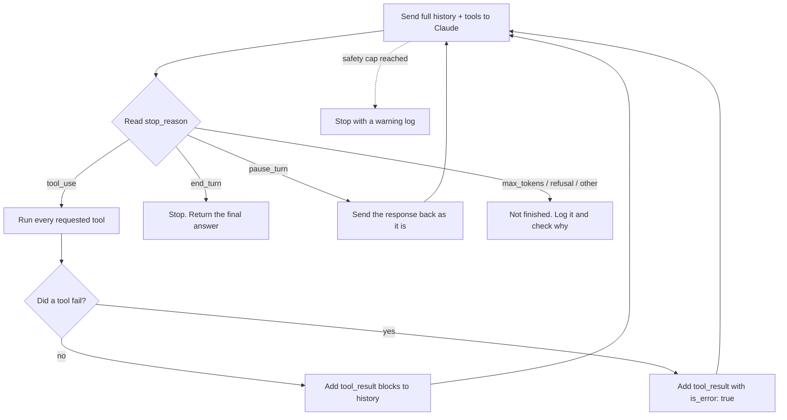

# Domain 1: Agentic Architecture & Orchestration

> **Exam weight:** 27% of scored items (official exam guide v1.0, §4). This is the largest domain.
> **Task statements:** 1.1 to 1.7 (see [docs/domain-map.md](../docs/domain-map.md)).
> **Deep dives:** [domain-1-agentic-architecture-orchestration/](../domain-1-agentic-architecture-orchestration/README.md)
> **Facts checked against:** [docs/verification-log.md](../docs/verification-log.md). ⚠️ marks a place where the exam answer and today's product differ.

---

## Exam focus

- **The agentic loop (1.1).** You must know when the loop continues and when it stops. You must also know the three classic loop bugs.
- **Coordinator and subagents (1.2, 1.3).** You must know how information moves between agents. Subagents only know what you put in their prompt.
- **Code vs prompt enforcement (1.4, 1.5).** You must choose code (gates, hooks) when a rule must hold every time. This applies to money, security, and compliance.
- **Task decomposition (1.6).** You must match the pattern to the task. Use a fixed pipeline for known steps and an adaptive plan for unknown scope.
- **Sessions (1.7).** You must choose between resuming, forking, and starting fresh with a summary.

---

## Key concepts

### 1. Words you need first

An **agent** is a program where Claude decides the next step, often by calling tools.

A **tool** is a function your code offers to Claude, for example `get_customer`. Claude asks for a tool call. Your code runs it.

The **Messages API** is the Claude API you call to get a reply. It is **stateless**: it remembers nothing between calls. So each request must contain the full conversation history.

The **Claude Agent SDK** (software development kit) is Anthropic's library for building agents. It runs the loop for you and adds features such as subagents, hooks, and sessions.

### 2. The agentic loop (Task 1.1)

An **agentic loop** is code that calls Claude again and again until the task is finished. Your code controls the loop. Claude decides which tools to use inside it.

**The loop has five steps:**

1. **Send** the messages (system prompt, history, tools) to Claude.
2. **Get** the response and read its `stop_reason` field.
3. **Run** each tool that Claude asked for, if `stop_reason` is `"tool_use"`.
4. **Return** the results as `tool_result` blocks in a new user message. Add them to the history.
5. **Repeat** from step 1. Stop when `stop_reason` is `"end_turn"`.



If Mermaid does not render, here is the same loop in plain text:

```text
        +--------------------------------------------+
        |  1. Send full history + tools to Claude    |<-----------+
        +--------------------------------------------+            |
                            |                                     |
                    2. read stop_reason                           |
          +-----------------+-------------------+                 |
     "end_turn"        "tool_use"         anything else           |
          |                 |                   |                 |
     STOP: return     3. run each tool     not finished:          |
     final answer           |              log + investigate      |
                      4. add tool_result                          |
                      blocks (is_error if                         |
                      a tool failed) ------- 5. repeat -----------+
```

**Why `stop_reason` and not the text?** `stop_reason` is a structured signal from the API. Text is not reliable. A reply can contain text **and** a tool call together. So "the reply has text" does not mean "the task is done".

**Stop conditions.** The docs list seven `stop_reason` values. The exam guide uses only the first two.

| Value | Meaning | What your loop does |
|---|---|---|
| `tool_use` | Claude wants one or more tools. | Run them, return results, continue. |
| `end_turn` | Claude has finished its answer. | Stop and return the answer. |
| `max_tokens` | The reply hit your `max_tokens` limit. | Not finished. Check why (raise the limit or split the task). |
| `pause_turn` | A server-side tool loop paused. | Send the response back as it is and call again. |
| `refusal` | Claude declined to answer. | Do not retry blindly. Log it and handle it. |
| `stop_sequence` | A stop sequence you set was reached. | Handle it as your design says. |
| `model_context_window_exceeded` | The context window is full. | Not finished. Reduce context. |

**Model-driven vs fixed sequence.** In a good agent, Claude chooses the next tool from the context. This adapts better than a hard-coded decision tree. The exception is high-risk rules (see Task 1.4). Those need code.

**A minimal loop in Python:**

```python
import logging
import anthropic

client = anthropic.Anthropic()
MODEL = "<a current Claude model ID>"
SAFETY_CAP = 25  # a safety net only, NOT the main way to stop

def run_agent(messages, tools, run_tool):
    for _ in range(SAFETY_CAP):
        response = client.messages.create(
            model=MODEL, max_tokens=4096, tools=tools, messages=messages
        )
        # Always keep Claude's reply in the history (the API is stateless).
        messages.append({"role": "assistant", "content": response.content})

        if response.stop_reason == "end_turn":
            return response  # finished

        if response.stop_reason == "tool_use":
            results = []
            # Claude may ask for several tools at once. Answer all of them.
            for block in response.content:
                if block.type != "tool_use":
                    continue
                try:
                    output = run_tool(block.name, block.input)
                    results.append({"type": "tool_result",
                                    "tool_use_id": block.id,
                                    "content": output})
                except Exception as err:
                    # Tell Claude the tool failed, so it can choose another path.
                    results.append({"type": "tool_result",
                                    "tool_use_id": block.id,
                                    "content": f"Tool failed: {err}",
                                    "is_error": True})
            # All tool_result blocks go in ONE user message, before any text.
            messages.append({"role": "user", "content": results})
            continue

        if response.stop_reason == "pause_turn":
            continue  # send the paused turn back as it is

        # max_tokens, refusal, model_context_window_exceeded, stop_sequence
        raise RuntimeError(f"Agent stopped early: {response.stop_reason}")

    logging.warning("Safety cap reached. Check for a stuck loop.")
    raise RuntimeError("Safety cap reached")
```

**Error handling inside the loop:**

- **A tool fails while running.** Return a `tool_result` with `is_error: true` and a clear message. Claude can then retry, pick another tool, or explain the problem. Do not crash the loop. Do not hide the failure.
- **Every `tool_use` needs a matching `tool_result`.** Each result uses the same `tool_use_id`. A missing result makes the next API call fail with an error.
- **Tool results come first.** In the user message, `tool_result` blocks must come before any text.
- **API errors** (for example, the service is busy) are different. They happen before you get a response. Retry the API call with **backoff** (wait a little longer after each failed try).

**How loops fail** (the exam uses these as wrong answers):

| Failure | What you see | Real cause | Correct fix |
|---|---|---|---|
| Stops too early | The agent quits in the middle of complex tasks. | The code checks "is the first block text?" | Check `stop_reason`. |
| Stops on words | It stops when Claude writes "Done!". | The code parses natural language. | Check `stop_reason`. |
| Cut off | Long tasks are cut off at step 10. | An iteration cap is the main stop rule. | Use `stop_reason`. Keep the cap only as a safety net. |
| Never ends | The agent keeps calling tools. | `tool_choice: "any"` forces a tool call every turn, so `end_turn` never comes. | Use `"auto"` in the loop. |
| Forgets results | Claude asks for the same data again. | Tool results are not added to the history. | Append every `tool_result`. |
| Gives up silently | A tool error ends the run with no answer. | Exceptions are not caught. | Return `is_error: true`. |

### 3. Coordinator and subagents (Task 1.2)

A **coordinator** is the main agent. It splits the task, starts helper agents, and joins their results. A **subagent** is a helper agent with its own fresh context.

The exam pattern is **hub-and-spoke**. All information goes through the coordinator, like spokes on a wheel. Subagents do not talk to each other. This gives one place for logging, error handling, and control.

A subagent has **isolated context**. It does not see the coordinator's history. It also does not remember earlier calls. Every call starts empty.

The coordinator has four jobs:

1. **Decompose:** split the task into parts.
2. **Delegate:** choose which subagents to call. A simple question may need only one subagent, not the full pipeline.
3. **Aggregate:** join the results.
4. **Refine:** check the result for gaps. Send targeted follow-up queries, then run synthesis again.

The biggest coordinator risk is a **decomposition that is too narrow**. Example: a report on "AI in creative industries" covers only visual art. The subagents did their jobs well. The coordinator gave them too small a scope. Fix the coordinator's split, not the subagents.

To avoid duplicate work, give each subagent a **different subtopic or source type**.

### 4. Starting subagents and passing context (Task 1.3)

Subagents are started with a tool. The exam guide calls it the **Task** tool. The coordinator needs this tool in its `allowedTools` list.

> ⚠️ **Product note:** current Claude Code and Agent SDK docs call this tool **Agent**. "Task" still works as an alias (verification log C1a).

An **`AgentDefinition`** describes one subagent type. It has a `description` (when to use it), a `prompt` (its system prompt), and optional `tools` (which tools it may use).

**Pass everything in the prompt.** If the synthesis subagent needs search results, put the full results in its prompt. Use a **structured format** that keeps content and **metadata** (data about the data) apart:

```json
{
  "claim": "Streaming revenue grew 18% in 2025",
  "source_url": "https://example.org/report",
  "document": "Industry Report 2025",
  "page": 12
}
```

If you pass only plain summaries, the source links are lost. Then the final report has no citations. The fix is upstream: pass the metadata. Giving the synthesis agent search tools does not fix it.

**Parallel subagents.** If subtasks are independent, the coordinator should ask for **several Task calls in one response**. They then run at the same time. One call per turn makes them run one after another.

**Write goals, not scripts.** Tell subagents the goal and the quality bar. Do not write step-by-step procedures. Subagents can then adapt to what they find.

> ⚠️ **Product note:** the exam treats direct subagent-to-subagent talk as always wrong. Current Claude Code lets a subagent start its own subagents, up to three layers deep (verification log C3). This does not change the hub-and-spoke exam answer.

### 5. Enforcing workflow steps and handoffs (Task 1.4)

You can control step order in two ways:

- **Prompt guidance.** You write "Always verify the customer first" in the prompt. This works most of the time, but it is **probabilistic**: it can fail.
- **Programmatic enforcement.** Code blocks the step. This is **deterministic**: it works every time.

**Rule:** if one failure can cost money, break security, or break compliance, use code. Use prompts only for low-risk things like tone or format.

A **prerequisite gate** is code that blocks a tool until an earlier step is done. Example: `process_refund` returns an error until `get_customer` has returned a verified customer ID. If a prompt already states the right order and still fails 8% of the time, a stronger prompt is not the fix. A gate is.

**Several issues in one message.** Split the request into separate issues. Investigate them in parallel with shared context. Then give one combined answer.

**Handoff to a human.** The human agent cannot see the chat transcript. So the handoff must stand alone. Include:
- the customer ID
- a short summary
- the root cause
- the amount
- the recommended action

### 6. Agent SDK hooks (Task 1.5)

A **hook** is your code that runs at a fixed point in the agent's work.

- **`PreToolUse`** runs **before** a tool runs. It can block the call, change its input, or send it elsewhere. Use it for policy rules. Example: block refunds above $500 and route them to a human.
- **`PostToolUse`** runs **after** a tool runs. It can change the result before Claude reads it. Use it to **normalize** data: turn mixed formats (Unix time, ISO 8601 dates, numeric status codes) into one format.

A PostToolUse hook cannot stop an action. The tool has already run.

Hooks give **guaranteed** behavior. Prompts give **likely** behavior. If a rule must hold 100% of the time, use a hook.

### 7. Task decomposition (Task 1.6)

**Decomposition** means splitting a big task into smaller steps. There are two main patterns:

| Pattern | When to use | Example |
|---|---|---|
| **Fixed sequential pipeline** (also called **prompt chaining**: each step's output feeds the next prompt) | The steps are known in advance. | Code review, form extraction, a compliance checklist |
| **Dynamic adaptive decomposition** (the plan changes as you learn) | The scope is unknown at the start. | Adding tests to a legacy codebase, a security audit, open research |

**Attention dilution** happens when one pass covers too many files. Early files get careful feedback. Later files get little. The same pattern may be flagged in one file and approved in another. The fix is **one pass per file plus one cross-file integration pass**. A bigger context window does not fix it.

### 8. Sessions: resume, fork, or start fresh (Task 1.7)

A **session** is one saved conversation with its history.

- **Resume** (`--resume <name>`, or `resume` in the SDK): continue the same session. Use it when the old context is still valid.
- **Fork** (`fork_session`): start a new branch from the same point. Use it to compare two approaches from one shared analysis.
- **Fresh start with a summary:** start a new session and inject a structured summary. Use it when old tool results are **stale**, meaning they no longer match the files.

When you resume after a few known file changes, tell the agent exactly which files changed. Then it can re-check only those files. Do not re-read the whole codebase.

> ⚠️ **Review item:** the cheat sheet says "never resume after files changed". The exam guide (1.7) accepts telling a resumed session about specific changes. See [REVIEW_NEEDED.md](../REVIEW_NEEDED.md) item R1. For heavy changes or a messy history, both sources agree: start fresh with a summary.

---

## Common traps

| Tempting wrong answer | Why it is wrong |
|---|---|
| "Stop the loop when Claude says it is done." | Text is not a control signal. Use `stop_reason`. |
| "Raise the iteration cap so long tasks finish." | A cap is a safety net. It does not fix early stops, and it can cut off real work. |
| "End the loop when the reply contains text." | Text and a tool call can come in the same reply. |
| "Set `tool_choice: \"any\"` so Claude keeps working." | The agent then must call a tool every turn and never reaches `end_turn`. |
| "Write a stronger system prompt so the agent always verifies identity first." | Prompts lower the failure rate but never to zero. Money and security need a gate or hook. |
| "Add few-shot examples to guarantee the order." | Examples help consistency. They do not guarantee anything. |
| "Use a PostToolUse hook to block large refunds." | PostToolUse runs after the tool. The refund already happened. Use PreToolUse. |
| "Let subagents message each other directly to save time." | This breaks hub-and-spoke. You lose observability and error control. |
| "The subagent should remember the earlier call." | Each subagent call starts with empty context. Pass what it needs. |
| "The report lacks citations, so improve the synthesis prompt." | The synthesis agent never received source metadata. Fix what is passed to it. |
| "Add more subagents to fix missing topics." | The coordinator's split is too narrow. More agents with the same split miss the same topics. |
| "Use a bigger model or bigger context window for uneven reviews." | This is attention dilution. Split into per-file passes plus a cross-file pass. |
| "Use `fork_session` to fix stale results." | A fork copies the stale history too. |
| "Use a routing classifier to fix skipped steps." | Classifiers choose where a request goes. They do not enforce order inside one agent. |

---

## Worked scenario

**Setting:** You build a customer support agent with the Agent SDK. Its tools are `get_customer`, `lookup_order`, `process_refund`, and `escalate_to_human`. Company policy: refunds above $500 need a human. Identity must be verified before any refund.

**Step 1: Build the loop.**
- The loop calls Claude and checks `stop_reason`.
- On `"tool_use"`, it runs every requested tool and returns all results in one user message.
- On `"end_turn"`, it returns the answer.
- A cap of 25 turns is added only as a safety net, with a warning log.

**Step 2: Add the identity gate.**
- Tests show the agent sometimes calls `process_refund` before `get_customer`.
- The prompt already says "verify first", so a stronger prompt will not make this reliable.
- You add a gate: `process_refund` returns an error unless a verified customer ID is in the session state.

**Step 3: Add the refund limit hook.**
- You add a `PreToolUse` hook on `process_refund`.
- If the amount is above $500, the hook blocks the call and starts the escalation workflow instead.
- This works every time, unlike a prompt rule.

**Step 4: Normalize data.**
- `lookup_order` returns Unix timestamps.
- The shipping tool returns ISO 8601 dates.
- A `PostToolUse` hook converts both to ISO 8601 before Claude reads them.

**Step 5: Handle a tool failure.**
- The shipping system times out.
- The tool returns `is_error: true` with "Shipping service timed out. Try again in 30 seconds."
- Claude tells the customer about the delay. It does not invent a delivery date.

**Step 6: Handle a multi-issue message.**
- A customer writes: "My order is late, I was charged twice, and I want to change my address."
- The agent treats these as three issues.
- It checks each issue with shared customer context, then gives one combined reply.

**Step 7: Hand off.**
- The duplicate charge is $640, above the limit.
- The hook blocks the refund.
- The agent calls `escalate_to_human` with:
  - the customer ID
  - the issue summary
  - the root cause (a payment retry created two charges)
  - the amount
  - the recommended action

The human agent can act without reading the chat.

---

## Quick recap

- Control the loop with `stop_reason`: continue on `"tool_use"` and stop on `"end_turn"`. Treat other values as "not finished, check why".
- Add every tool result to the history. On a tool failure, return `is_error: true` and keep the loop alive.
- Use hub-and-spoke. Subagents start empty and know only what is in their prompt.
- Pass findings as structured data with source metadata. Start independent subagents in one response.
- Use code (gates, `PreToolUse` hooks) for money, security, and compliance. Use prompts for low-risk style rules.
- Use a fixed pipeline for known steps and an adaptive plan for unknown scope. Use per-file passes plus a cross-file pass for big reviews.
- Resume when the context is valid. Fork to compare approaches. Start fresh with a summary when the history is stale.

---

## Practice questions

Go to the Domain 1 question bank: **[mcq-bank/01-agentic-architecture.md](../mcq-bank/01-agentic-architecture.md)** (65 questions).
Older, easier warm-up questions: [domain-1-.../08-scenario-practice-questions.md](../domain-1-agentic-architecture-orchestration/08-scenario-practice-questions.md).
